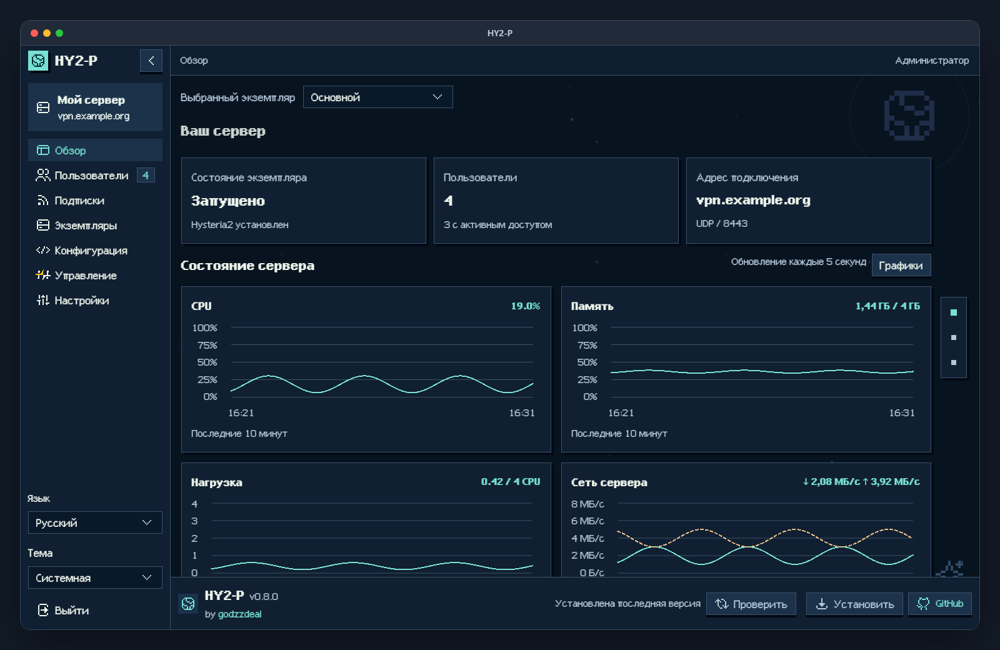
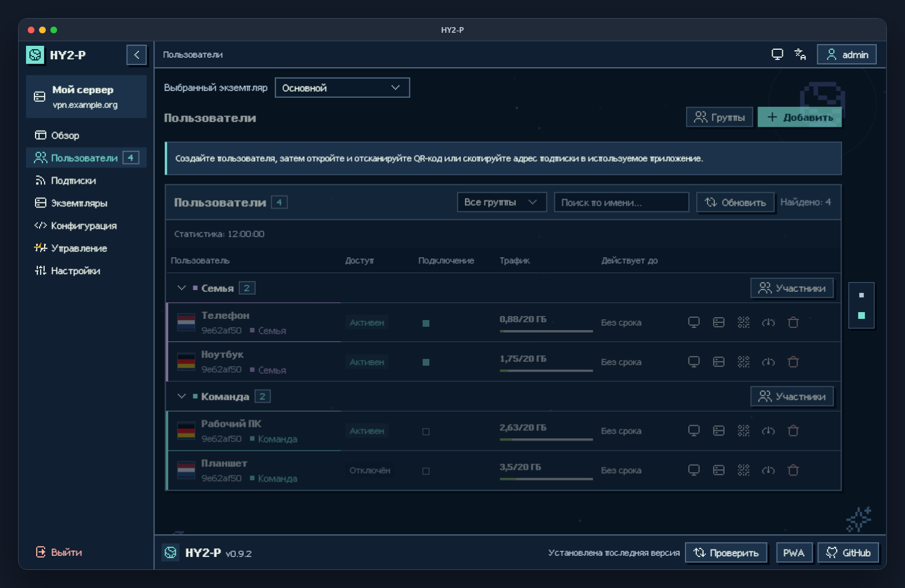
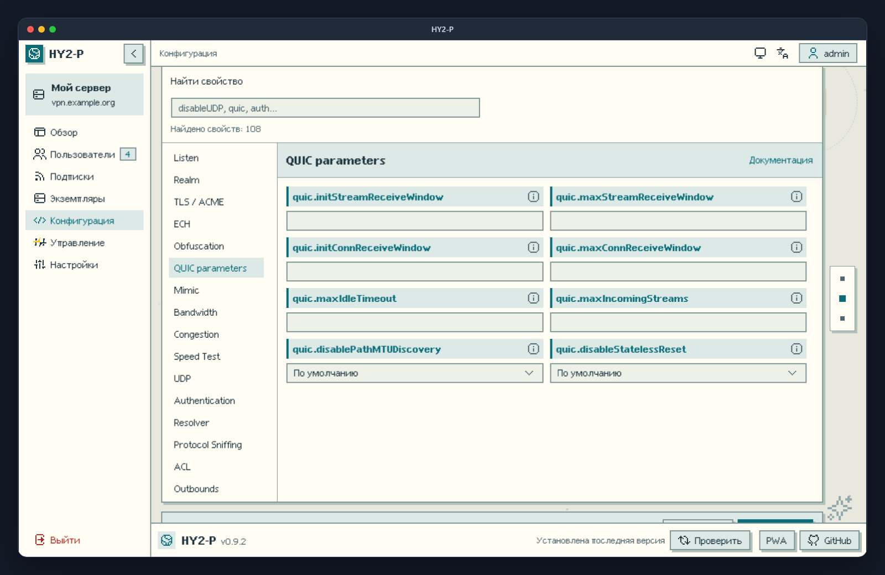

<div align="center">
  
  <h1>HY2-P</h1>
  <p>Панель управления Hysteria2 для вашего сервера</p><p><a href="https://hy2-p.vercel.app" title="Открыть демоверсию HY2-P на Vercel"></a><br><sub>Без установки, с учебными данными. После выхода логин и пароль: <code>demo</code> / <code>demo</code>.</sub></p>
  <p><a href="https://github.com/godzzdeal/hy2-p/releases/latest"></a> <a href="https://github.com/godzzdeal/hy2-p/actions/workflows/ci.yml"></a> <a href="https://github.com/godzzdeal/hy2-p/stargazers"></a></p>
</div>

**[Демоверсия на Vercel](https://hy2-p.vercel.app) | [Установка](docs/install.md) | [Бесплатный домен FreeDNS](docs/install.md#бесплатный-домен-freedns) | [Управление](docs/management.md) | [Релизы](https://github.com/godzzdeal/hy2-p/releases) | [Roadmap](ROADMAP.md)**

Создавайте пользователей, выдавайте подписки и управляйте несколькими ядрами Hysteria2 из браузера. Панель устанавливается в Docker на Ubuntu и работает с Happ на телефоне и компьютере.

## Что умеет панель

- **Несколько ядер.** До 8 независимых конфигураций со своими портами, версиями и журналами.
- **Управление доступом.** Пользователи и группы, срок действия, лимиты трафика и выбор ядер для подписки.
- **Подключение за пару нажатий.** Подписки Happ, ссылки `hy2://`, QR-коды, флаги и эмодзи.
- **Учёт устройств.** Лимит через подписку Happ, модель, ОС, IP и состояние подключения.
- **Обновления и откат.** Выбор версии Hysteria2, watchdog, перезапуск и возврат предыдущего ядра при сбое.
- **Настройка сервера.** Свойства из документации Hysteria2, редактор YAML, TLS/ACME, ECH и Traffic Stats.
- **Доступ с телефона.** Русский и английский языки, светлая и тёмная темы, установка как веб-приложения.
- **Firewall Ubuntu.** Просмотр и изменение правил UFW через локального помощника.
- **Облачный пароль.** Дополнительный пароль на втором шаге входа в панель.

<p align="center"><a href="https://hy2-p.vercel.app" title="Попробовать HY2-P в браузере"></a></p>
<p align="center"><a href="docs/images/users.png"></a> <a href="docs/images/configuration.png"></a></p>

## Установка

Нужен сервер с публичным IP, Ubuntu 22.04 или новее и доступ по SSH с правами sudo. Поддерживаются amd64 и arm64. Установщик скачивает готовый Docker-образ, собирать проект на сервере не нужно.

**1. Подготовьте домен.** Создайте A-запись с IP сервера. Если домена нет, подойдёт [бесплатный поддомен FreeDNS](docs/install.md#бесплатный-домен-freedns). Можно обойтись без домена и входить через SSH-туннель.

**2. Разрешите порты.** По умолчанию используются TCP `9443` для панели, TCP `80` для проверки ACME и UDP `8443` для Hysteria2. Откройте их в firewall сервера и хостинга. Сохраните доступ к своему SSH-порту.

**3. Запустите установщик на сервере.**

```bash
curl -fsSL https://github.com/godzzdeal/hy2-p/releases/latest/download/install.sh -o /tmp/hy2-install.sh
sudo bash /tmp/hy2-install.sh
```

Мастер спросит домен и email, при необходимости установит Docker и покажет адрес панели, логин и случайный пароль. Сохраните их. Логин по умолчанию: `admin`. Без домена установщик покажет команду SSH-туннеля.

## Первое подключение

1. Войдите в панель и откройте **Конфигурация** выбранного ядра.
2. Задайте публичный адрес и UDP-порт. Включите **SNI совпадает с адресом**, если используете этот же домен для сертификата.
3. В **TLS / ACME** укажите сертификат с ключом или настройте ACME для своего домена.
4. В **Authentication** оставьте **Пользователи панели**, сохраните конфигурацию и запустите ядро.
5. Если меняли UDP-порт, нажмите **Применить UDP-порт** и дождитесь проверки.
6. Создайте пользователя, откройте **Подключение** в его меню и импортируйте подписку в Happ.

Сертификаты панели и ядра настраиваются отдельно. Для HTTP-проверки ACME нужен доступный извне TCP-порт `80`.

## Happ

**[Сайт и загрузка](https://happ.info/ru/) | [Документация на GitHub](https://github.com/HappDev/happ_su) | [Установка на iOS и регион App Store](https://happ.info/ru/apple-region/?ref=rus)**

HY2-P хорошо работает с Happ. Скопируйте подписку пользователя, нажмите **+** в Happ и добавьте её из буфера обмена. Также можно отсканировать QR-код. Если пользователю доступны несколько ядер, они появятся в одной подписке.

На iPhone и iPad установите Happ с официального сайта. Если приложение недоступно в вашем App Store, откройте инструкцию для iOS по ссылке выше.

После смены адреса, порта или пароля обновите подписку в приложении. При включённом лимите устройств нужна именно подписка. Модель и ОС сообщает Happ, поэтому это учёт устройств, а не защита от копирования профиля.

## Пример конфигурации

Использую этот конфиг с Happ. Он не универсальный: в другой сети или у другого оператора могут понадобиться изменения.

<details>
<summary><strong>Открыть YAML</strong></summary>

```yaml
listen: :61254

acme:
  domains:
    - vpn.example.com
  email: admin@example.com
  ca: letsencrypt
  dir: /data/acme-hy2

obfs:
  type: salamander
  salamander:
    password: REPLACE_WITH_YOUR_RANDOM_OBFS_PASSWORD

quic:
  maxIdleTimeout: 30s
  disablePathMTUDiscovery: false

ignoreClientBandwidth: true

congestion:
  type: bbr
  bbrProfile: standard

disableUDP: false
udpIdleTimeout: 60s

trafficStats:
  listen: 127.0.0.1:9999
  secret: REPLACE_WITH_YOUR_RANDOM_STATS_SECRET

masquerade:
  type: proxy
  proxy:
    url: https://reuters.com
    rewriteHost: true
```

</details>

Укажите свой домен, email и пароль Salamander. В параметрах подключения задайте UDP-порт `61254`, сохраните конфигурацию и примените порт. Подписка передаст пароль обфускации в Happ.

В режиме **Пользователи панели** поля `auth`, `trafficStats.listen` и `trafficStats.secret` задаёт HY2-P. Текущий секрет можно получить в разделе **trafficStats**. Для ECH используются отдельные ключи, ACME-сертификат их не содержит. Salamander не превращает соединение в HTTPS.

## Обновление и откат

**[Команды, резервные копии и восстановление](docs/management.md)**

```bash
sudo hy2-panel update
```

Перед обновлением создаётся резервная копия. Если новая панель не запускается, установщик пробует восстановить предыдущую версию. Для ручного отката:

```bash
sudo hy2-panel rollback
```

Откат возвращает и данные из копии перед обновлением. Новые изменения после этой копии не сохранятся. Ядро Hysteria2 обновляется отдельно в разделе **Ядро и журнал**.

## Firewall

При установленном и настроенном UFW подключите помощник:

```bash
sudo hy2-panel firewall-setup
```

Откройте **Настройки → Firewall сервера**. Помощник не включает UFW автоматически; SSH-порты и порт панели защищены от изменения. Опубликованные порты Docker могут обходить UFW. Правила хостинга настраиваются в личном кабинете провайдера.

После обновления с 0.7.0 повторите `sudo hy2-panel firewall-setup`, чтобы заменить помощник версией на Go. Правила UFW сохранятся.

## Документация и помощь

- [Подробная установка](docs/install.md), включая бесплатный домен FreeDNS.
- [Ручной запуск в Docker](docs/docker.md).
- [Документация Hysteria2](https://v2.hysteria.network/docs/getting-started/Installation/).
- [Сообщить об ошибке](https://github.com/godzzdeal/hy2-p/issues). Приложите версию панели и журнал без паролей, ключей и ссылок подписки.
